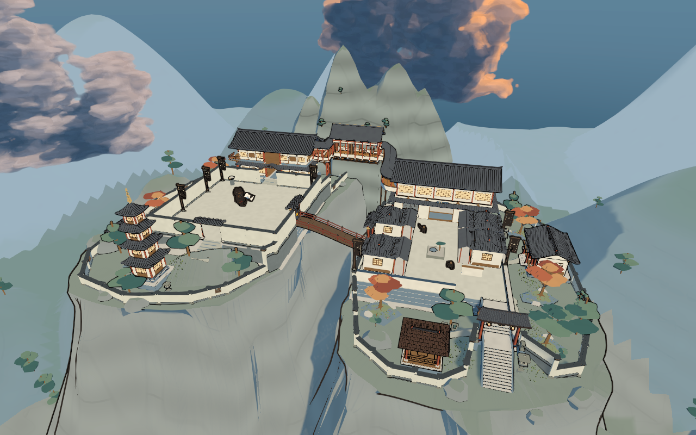
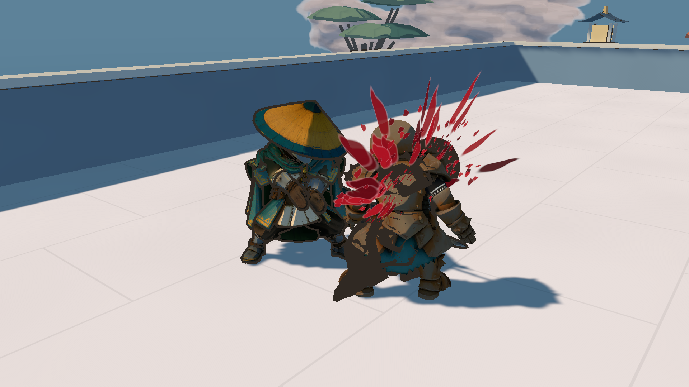
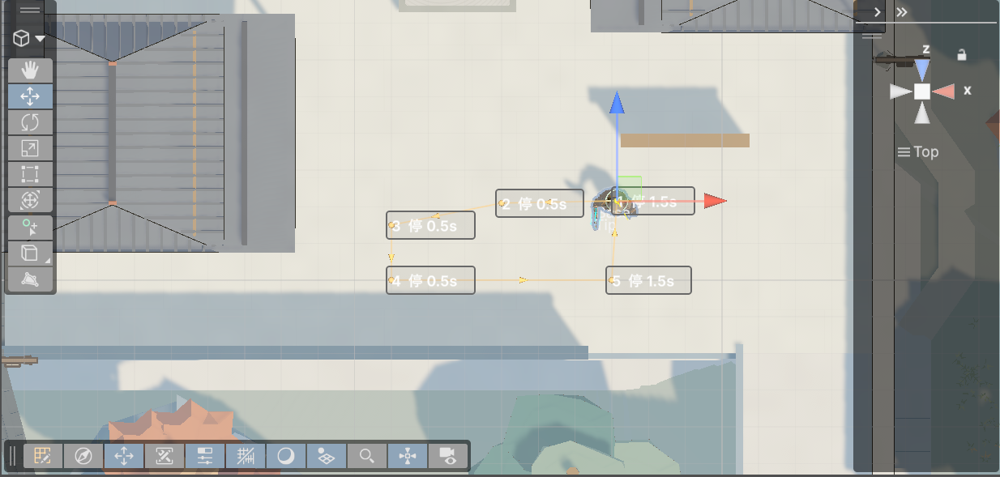

# Katana

Unity 第三人称近战原型，使用 **C# / URP / Blender**，实现架势连段、精力与残心、格挡弹反、双人处决及山寺探索关卡。

## 技术实现

- **战斗架构**：`ScriptableObject` 配置招式与架势；玩家和 AI 共用输入帧、动作状态机及每角色唯一 `Tick`。
- **近战判定**：动画后采样武器轨迹，`SphereCast` 扫掠与初始重叠补偿；按命中窗口去重，处理阵营过滤与墙体遮挡。
- **动画与移动**：Humanoid 重定向、八向步态相位衔接；根轨迹增量交给 `CharacterController`，配套双人处决对位与起身衔接。
- **AI 与巡逻**：行为树生成输入，脱战沿实际追击轨迹返回；Scene 路点支持贴地拖动、停留朝向、循环/往返与 Undo。
- **漫画渲染**：URP 自定义明暗分层、描边、世界空间岩层材质与镜头遮挡处理。
- **关卡工具**：Blender 模块化资产与连续坡面碰撞；钥匙及门状态与检查点分开持久化。

| 双人处决 | Scene 巡逻路线编辑 |
| :---: | :---: |
|  |  |

## 运行

1. 安装 Git LFS，克隆后执行 `git lfs pull` 拉取模型资源。
2. 用 Unity Hub 以 **6000.6.5f1** 打开项目，等待依赖还原与导入；Git 包依赖需要访问 GitHub。
3. 打开 `Assets/KatanaDemo/SamuraiCombat/Scenes/SamuraiCombatDemo_BlenderAssembly.unity`，进入 Play 后点击游戏画面。

[操作说明](Assets/KatanaDemo/SamuraiCombat/使用说明.txt) · [架构与扩展](Assets/KatanaDemo/SamuraiCombat/架构与扩展说明.txt) · [巡逻编辑器](Assets/KatanaDemo/SamuraiCombat/巡逻路径编辑器使用说明.txt)
